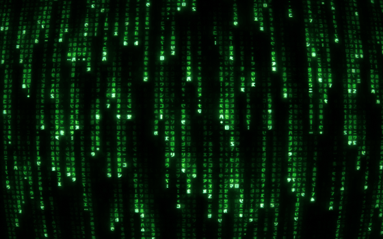
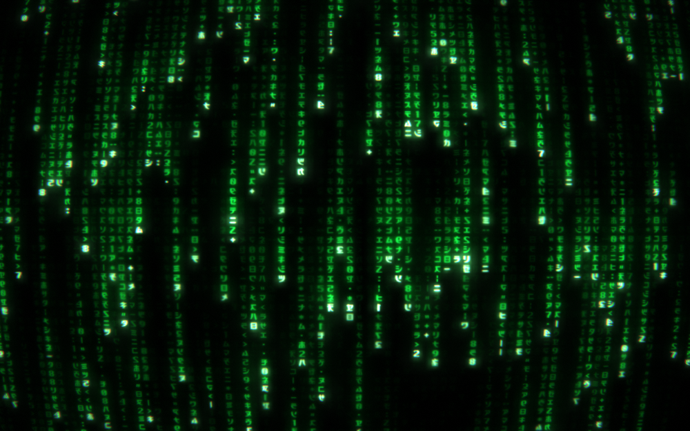
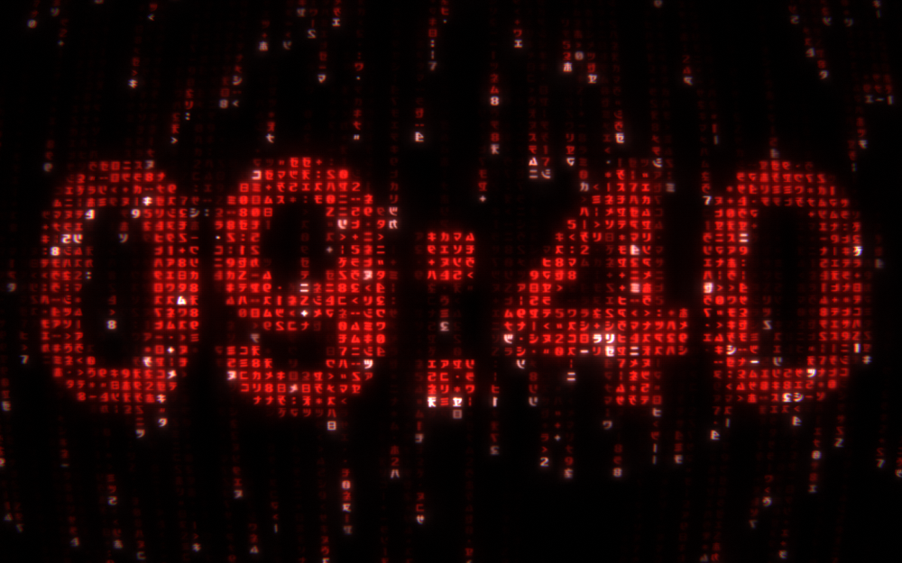

# Matrix Rain

**EN:** macOS screen saver with the "digital rain" look — Swift + Metal. &nbsp;·&nbsp; **PL:** wygaszacz ekranu w stylu „kodu Matrixa” — Swift + Metal.

[English](#english) · [Polski](#polski)

<p align="center">
  
</p>
<p align="center">
  
</p>
<p align="center">
  
</p>

---

## English

### Features

- Dense, layered rain with depth of field (far streams dimmer and blurred), mirrored glyphs, white heads with a glowing "neck"
- Multi-level bloom, chromatic aberration, film grain, flicker, glitch bands
- **CRT effects:** screen curvature that still fills the screen, scanlines, RGB phosphor mask, rolling refresh band, vignette
- **Image from code:** your photos or a live clock assembled out of falling glyphs (optionally in the photo's colors)
- 6 color themes: classic green, red pill, blue pill, gold, violet, mono
- **Extra effects:** wet-glass raindrops, ghost trails, brightness waves, 3D parallax depth, red alert on the hour, image dissolve into glyphs
- Options panel in tabs, **Polish / English** UI

### Requirements

macOS 12+, Xcode command-line tools (`xcode-select --install`), a Metal-capable Mac.

### Build & install

```bash
# screen saver -> ~/Library/Screen Savers/Matrix Rain.saver
./build.sh install

```

Then pick **Matrix Rain** in System Settings → Screen Saver. If an old version keeps showing up, switch to another
saver and back, or run `killall legacyScreenSaver`.

### Font

The original look uses the *Matrix Code* font (e.g. "Matrix Code NFI"). It is **not** included in this repository.
Put your own copy at `Resources/Matrix-Code.ttf` before building. Without it the build falls back to a system
katakana font (the rain still works, glyphs just look different).

### Options (screen saver)

| Tab | Settings |
|---|---|
| Look | color theme, glyph size, brightness, glow, vignette |
| Motion | density, speed, glitch, auto-zoom of glyphs (range + cycle) |
| Effects | wet glass, ghost trails, brightness wave, 3D depth, red alert (hourly / 15 / 5 min) |
| CRT | curvature, scanlines, RGB mask, refresh band, grain |
| Image | rain only / photos / clock / photos + clock, image color, strength, change interval, choose photos (up to 12) |
| About | author, version, license |

The language list (Polski / English) is in the top-right corner of the options window.


---

## Polski

### Funkcje

- Gęsty, warstwowy deszcz kodu z głębią ostrości (dalsze strumienie ciemniejsze i rozmyte), odbite lustrzanie znaki, białe głowy ze świecącą „szyją”
- Wielopoziomowa poświata (bloom), aberracja chromatyczna, ziarno filmowe, migotanie, pasy glitch
- **Efekty CRT:** wygięcie ekranu wypełniające cały ekran, linie skanowania, maska RGB luminoforu, przesuwające się pasmo odświeżania, winieta
- **Obraz z kodu:** Twoje zdjęcia albo zegar na żywo układane ze spadających znaków (opcjonalnie w kolorach zdjęcia)
- 6 motywów kolorów: klasyczny zielony, czerwona pigułka, niebieska pigułka, złoto, fiolet, mono
- **Dodatkowe efekty:** krople na mokrej szybie, duchy znaków, fale jasności, głębia 3D z paralaksą, czerwony alarm o pełnej godzinie, rozpad obrazu na znaki
- Panel opcji w zakładkach, interfejs **po polsku i angielsku**

### Wymagania

macOS 12+, narzędzia wiersza poleceń Xcode (`xcode-select --install`), Mac z obsługą Metal.

### Budowanie i instalacja

```bash
# wygaszacz -> ~/Library/Screen Savers/Matrix Rain.saver
./build.sh install

```

Następnie wybierz **Matrix Rain** w Ustawieniach systemu → Wygaszacz ekranu. Jeśli nadal widać starą wersję, wybierz inny
wygaszacz i wróć albo uruchom `killall legacyScreenSaver`.

### Czcionka

Oryginalny wygląd używa czcionki *Matrix Code* (np. „Matrix Code NFI”). **Nie ma jej** w tym repozytorium.
Przed budową wstaw własną kopię do `Resources/Matrix-Code.ttf`. Bez niej skrypt użyje systemowej czcionki z katakaną
(deszcz działa, tylko znaki wyglądają inaczej).

### Opcje wygaszacza

| Zakładka | Ustawienia |
|---|---|
| Wygląd | motyw kolorów, rozmiar znaków, jasność, poświata, winieta |
| Ruch | gęstość, prędkość, glitch, auto-zoom znaków (zakres + cykl) |
| Efekty | mokra szyba, duchy znaków, fala jasności, głębia 3D, czerwony alarm (co godzinę / 15 / 5 min) |
| Ekran CRT | wygięcie, linie skanowania, maska RGB, pasmo odświeżania, ziarno |
| Obraz | tylko deszcz / zdjęcia / zegar / zdjęcia i zegar, kolor obrazu, widoczność, czas zmiany, wybór zdjęć (do 12) |
| Info | autor, wersja, licencja |

Lista języka (Polski / English) jest w prawym górnym rogu okna opcji.


---

## License / Licencja

MIT © 2026 Tomasz Marchewka — see / zobacz [LICENSE](LICENSE).

Unofficial fan project, not affiliated with or endorsed by the makers or owners of the film "The Matrix".
Nieoficjalny projekt fanowski, niezwiązany z filmem „Matrix” ani jego właścicielami.
